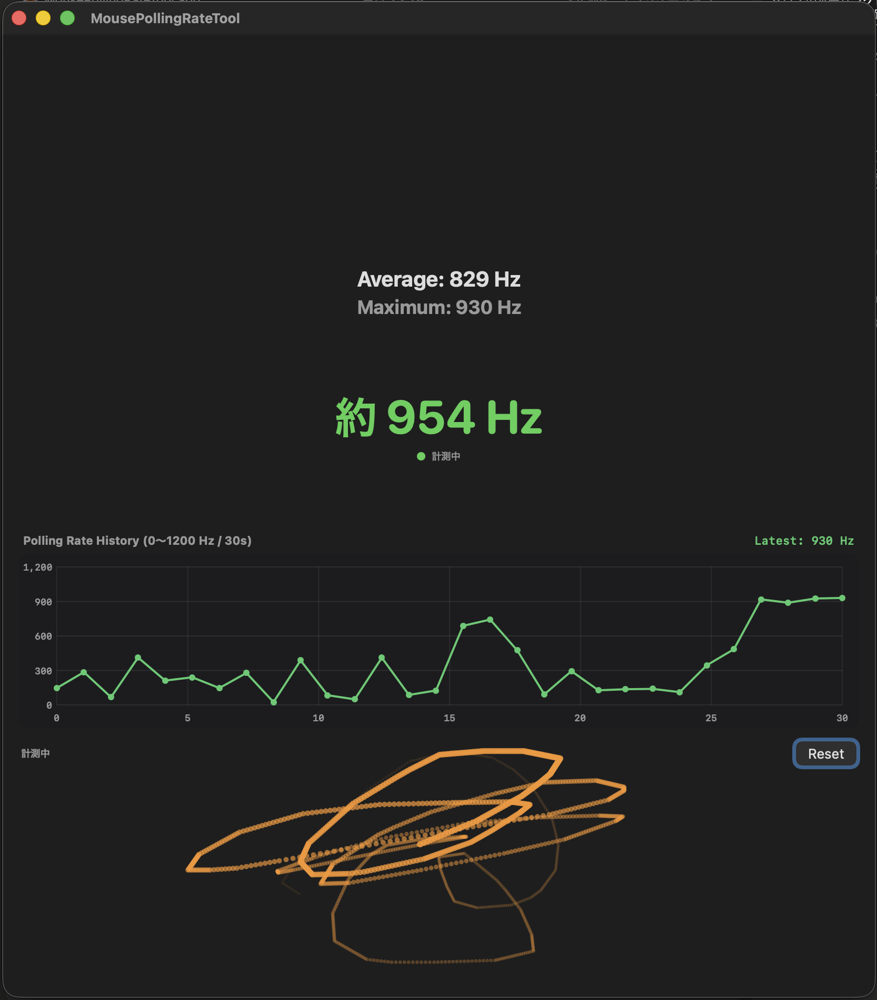
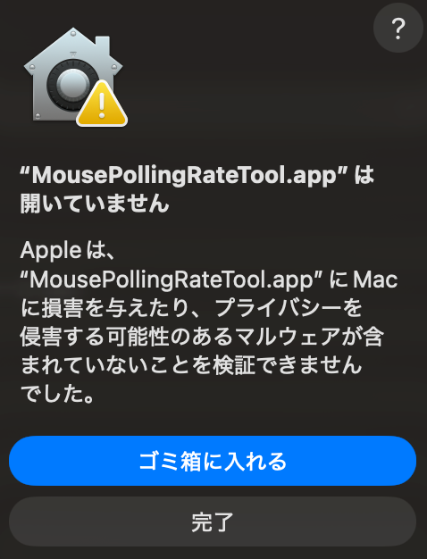
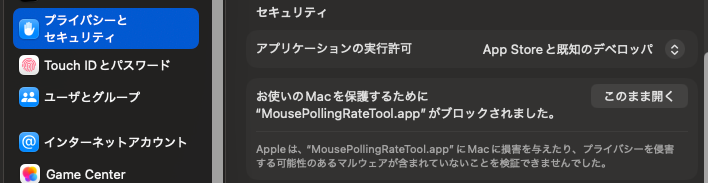
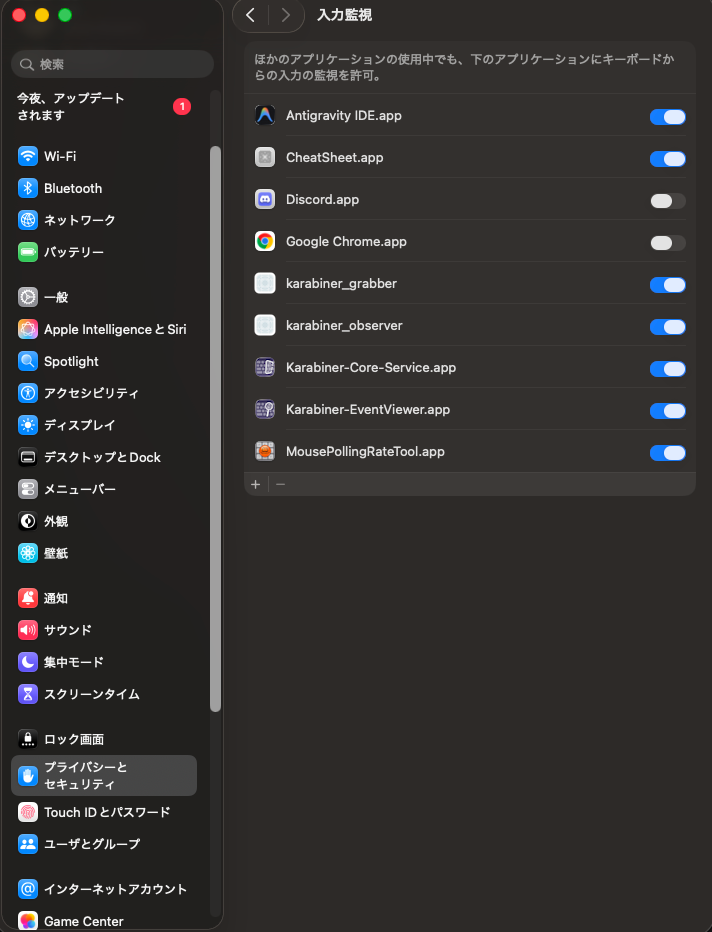

# MousePollingRateTool


マウスのポーリングレートを計測し、マウスカーソルの軌跡をリアルタイムで表示するmacOSアプリです。

## スクリーンショット



## 機能

- **ポーリングレート計測**：`IOHIDManager` を使用してマウスの生HIDパケット（X/Y軸イベント）を直接取得し、高精度にポーリングレート（Hz）を計測します（X軸だけでなくY軸のみの移動でも正確に計測されます）
- **直近5秒間の統計表示**：直近5秒間の平均ポーリングレート（Average）および最大値（Maximum）をリアルタイムに集計・表示します
- **ポーリングレート推移グラフ**：0〜1200Hzスケール、最大30秒間の履歴を1秒刻みの折れ線グラフで可視化します。30秒を超過すると左端から古いデータが自動的にスクロールアウトします
- **ポインター停止検知**：マウス操作が停止した際は自動的に「ポインター停止中」状態となり、計測やグラフの更新を一時停止します
- **ウィンドウ全体の軌跡表示**：マウスカーソルの軌跡をウィンドウ全体に美しく描画します（透過オーバーレイ）

## 動作環境

- macOS 14.0 (Sonoma) 以降
- Apple Silicon / Intel Mac

## インストール

### ビルド済みDMGパッケージを使用する場合（推奨）

1. [**MousePollingRateTool.dmg をダウンロード**](https://github.com/mentako-ya/MousePollingRateTool/raw/main/MousePollingRateTool.dmg) します。
2. ダウンロードした `MousePollingRateTool.dmg` をダブルクリックして開きます。
3. 表示されたウィンドウで **MousePollingRateTool** を **Applications** フォルダにドラッグ＆ドロップしてください。

### 初回起動時の設定手順（初回のみ）

本アプリを初めて起動する際、macOSのセキュリティ機能により **①Gatekeeperの解除** と **②入力監視の許可** の2つの設定が必要です。

#### 1. セキュリティ警告の解除（Gatekeeper）

本アプリはオープンソース（アドホック署名）のため、初回起動時に以下の警告が表示されて起動がブロックされる場合があります。



以下の手順でシステム設定から実行許可を行ってください。

1. 警告ダイアログの **「完了」** をクリックして閉じます。
2. **システム設定** → **プライバシーとセキュリティ** を開きます。
3. 画面下部（「セキュリティ」項目）に「**お使いのMacを保護するために“MousePollingRateTool.app”がブロックされました。**」と表示されるので、横の **「このまま開く」** をクリックします。



4. Macのログインパスワードまたは Touch ID で認証し、確認ダイアログで **「開く」** をクリックします。

#### 2. 入力監視の許可

マウスのポーリングレート（生HIDイベント）を直接計測するために、macOSの **入力監視（Input Monitoring）** 権限が必要です。

アプリが起動すると、以下のダイアログが表示されます。


以下の手順で権限を付与してください。

1. ダイアログの **「システム設定を開く」** をクリックします（自動的に「システム設定」の「入力監視」画面が開きます）。
   - 手動で開く場合: **システム設定 → プライバシーとセキュリティ → 入力監視**
2. アプリ一覧から **MousePollingRateTool** を探し、トグルスイッチを **オン（有効）** に切り替えます。



3. Macのログインパスワードまたは Touch ID で認証を行います。
4. 「“MousePollingRateTool”を今すぐ終了して再度開きますか？」と表示された場合は、**「終了して再度開く」** をクリックします（表示されない場合は一度アプリを手動で終了し、再起動してください）。

> [!NOTE]
> すでにトグルがオンになっているにもかかわらずダイアログが表示される場合は、一度トグルを **オフ** にしてから再度 **オン** に切り替え、アプリを再起動してください。

---

### ソースからビルドする場合

1. Xcodeでプロジェクトを開きます

```bash
open MousePollingRateTool.xcodeproj
```

2. `⌘+R` でビルド・実行します

#### （オプション）DMGパッケージをビルドする

以下のスクリプトを実行すると、XcodeビルドからDMG生成までを自動で行い、ルートディレクトリに `MousePollingRateTool.dmg` が生成されます。

```bash
./scripts/build_dmg.sh
```

## 使い方

1. `/Applications/MousePollingRateTool.app` を起動します
2. マウスを動かすと自動的に計測が開始され、リアルタイムHz、5秒平均/最大値、推移グラフ、ウィンドウ全体の軌跡が更新されます
3. マウス操作を止めると「ポインター停止中」となり、グラフや統計情報の進行が一時停止します
4. 「Reset」ボタン（または `⌘+R`）で計測結果やグラフ履歴をリセットできます

## 技術仕様

### ポーリングレート計測

`IOHIDManager` を使用してマウスのX軸（`kHIDUsage_GD_X`）およびY軸（`kHIDUsage_GD_Y`）の生イベントを監視します。同一HIDレポートのパケットを正しく1回のポーリングとして束ねることで、二重カウントを防ぎつつ、上下・左右いずれの方向への移動でも高精度にポーリングレート（Hz）を算出します。

### 軌跡の補完アルゴリズム

macOSの `NSEvent.mouseLocation` は画面のリフレッシュレート（60Hz/120Hz等）の周期でのみ更新されます。本アプリでは、リフレッシュレート間の高密度なマウス移動を生HIDイベントの移動量から幾何学的に復元・補完しています。

```
リフレッシュA: 開始座標 PA を記録、サンプルバッファをリセット
              ↓
  生HIDイベント受信: 各パケットの相対移動量 (dx, dy) とタイムスタンプを累積記録
              ↓
リフレッシュB: 終了座標 PB を取得
              生移動量の総和ベクトル V と 画面上の移動ベクトル S (PB - PA) から
              2D相似変換（回転＋スケーリング行列）を計算
              → 各HIDサンプルの累積移動ベクトルを画面座標系へ精密にフィッティング
              → 始点 PA から曲率を保ちながら終点 PB へ滑らかに着地する点列を生成
              ↓
次サイクル: PB を PA として繰り返す
```

リフレッシュレート間を単なる直線で等分するのではなく、**HIDセンサーが実際に捉えた移動量（dx, dy）の幾何学的軌跡を画面の始点・終点に完全に一致するようにフィッティング**するため、円弧や細かなカーブを描いた場合でも角張らず、極めて滑らかな軌跡が再現されます。

## ライセンス

MIT License
